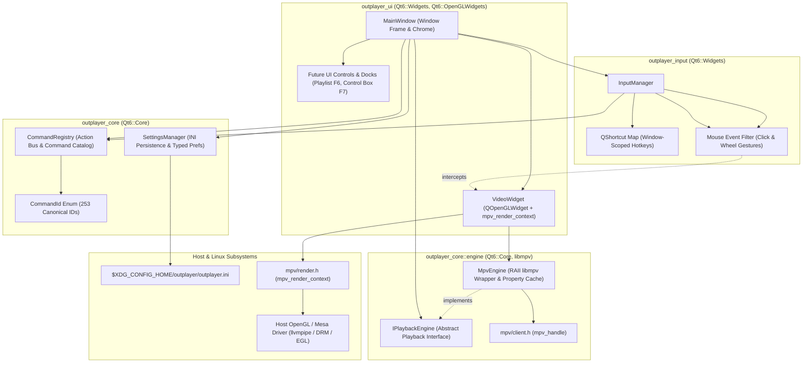
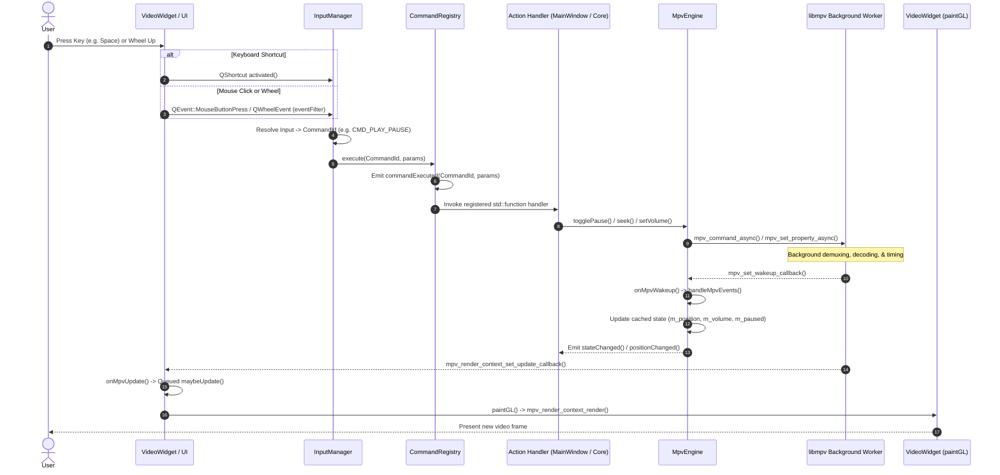
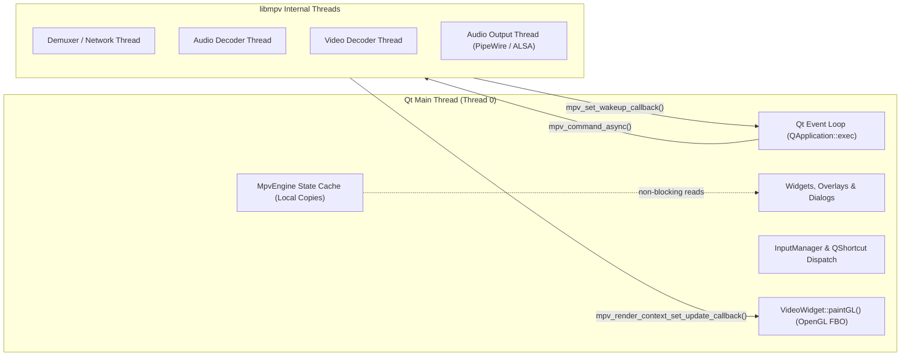

# outPlayer System Architecture

This document provides a comprehensive architectural description of **outPlayer**, a modern, high-performance Linux media player built with modern C++20, Qt 6, and `libmpv`.

---

## 1. Architectural Overview & Design Principles

`outPlayer` adheres to a decoupled, event-driven architecture designed to meet rigorous desktop multimedia requirements:
- **Instantaneous Responsiveness:** Sub-second cold startup, non-blocking asynchronous playback commands, and zero UI thread stalls during playback state transitions.
- **Strict Decoupling:** Clean separation of concerns between media decoding/rendering (`engine`), application commands and settings (`core`), input handling (`input`), and visual presentation (`ui`).
- **Zero UI Dependency in Core & Engine:** The core business logic, command registry, settings subsystem, and media engine contain zero dependencies on GUI/Widget frameworks (`QtWidgets`, `QtGui`, `QPainter`, `QShortcut`). This guarantees complete testability in headless environments (`ctest` with synthetic media).
- **Bus-Driven Command Plane:** All user actions (menus, keybindings, mouse gestures, CLI options, and future MPRIS2 D-Bus calls) dispatch through a unified `CommandRegistry` rather than hardcoding direct widget-to-engine slot connections.
- **Native Linux Standards Compliance:** Strict adherence to FreeDesktop XDG Base Directory specifications, Wayland/X11 windowing paradigms, and PipeWire/PulseAudio/ALSA audio pipelines.

---

## 2. System Component Graph

The diagram below illustrates the high-level component architecture and module relationships across the libraries:



---

## 3. Data & Command Flow Architecture

All interactions follow a deterministic flow from user trigger to target execution and visual rendering:



---

## 4. Component Dependency Boundary Rules

To prevent architectural drift and maintain testability, dependencies are strictly partitioned into CMake targets:

| Target Library | Permitted Qt Modules | Permitted External Libraries | Source Directory | Allowed Dependencies | Prohibited Dependencies |
|---|---|---|---|---|---|
| **`outplayer_core`** | `Qt6::Core`, `Qt6::Gui` (value types only) | `PkgConfig::MPV` | `src/core/`, `src/engine/` | Standard C++20 library, `mpv/client.h` | `QtWidgets`, `QtOpenGLWidgets`, widget/window headers |
| **`outplayer_input`** | `Qt6::Core`, `Qt6::Widgets` | None | `src/input/` | `outplayer_core` | `QtOpenGLWidgets`, direct `mpv` handles |
| **`outplayer_ui`** | `Qt6::Core`, `Qt6::Widgets`, `Qt6::OpenGLWidgets` | `PkgConfig::MPV` | `src/ui/` | `outplayer_core`, `outplayer_input`, `mpv/render.h` | Internal implementation leaks |
| **`outplayer` (exe)** | `Qt6::Widgets`, `Qt6::OpenGLWidgets` | None (via libs) | `src/main.cpp` | `outplayer_ui`, `outplayer_input`, `outplayer_core` | Circular dependencies |

### Architectural Boundary Invariants
1. **Zero Widget UI in `src/core`:** `src/core/` and `src/engine/` must compile without `Qt6::Widgets` or `Qt6::OpenGLWidgets` (`Qt6::Gui` is used strictly for `QColor` value types). Inclusion of `<QWidget>`, `<QAction>`, `<QPainter>`, `<QShortcut>`, or any widget/window header in these modules is a build violation.
2. **Abstract Engine Access:** Higher-level UI components should consume `IPlaybackEngine` rather than coupling directly to `MpvEngine` implementation details where feasible (except for `VideoWidget` which requires the `mpv_handle*` for OpenGL render context creation).
3. **Decoupled Command Handlers:** Handlers registered in `CommandRegistry` are lightweight lambdas or member functions connected via `std::function<void(const QVariantMap&)>`. Handlers do not block and dispatch asynchronously to the appropriate domain service.

---

## 5. Configuration Persistence Model (`SettingsManager`)

Configuration is managed by the singleton `SettingsManager` adhering to FreeDesktop standards:

### 5.1 Storage Locations & XDG Compliance
- **Primary Configuration Path:**  
  `$XDG_CONFIG_HOME/outplayer/outplayer.ini` (defaulting to `~/.config/outplayer/outplayer.ini` if `$XDG_CONFIG_HOME` is unset).
- **Runtime Override:**  
  Custom configuration file paths can be injected during startup using `SettingsManager::instance().init(customPath)` or via the `--config=<path>` command-line option.
- **Cache & State Directories (Phase 3+):**  
  - Cache: `$XDG_CACHE_HOME/outplayer/` (video thumbnails, font caches, resume timestamps).
  - Data: `$XDG_DATA_HOME/outplayer/` (playlists, favorites, playback history).

### 5.2 File Format & INI Structure
Settings are structured hierarchically using standard INI syntax backed by `QSettings::IniFormat`:

```ini
[General]
AllowMultipleInstances=false
RememberPlaybackPosition=true

[Playback]
Volume=100.0
Muted=false

[Video]
HardwareDecoder=auto-safe
Deinterlace=auto
AspectRatio=auto

[Audio]
AudioChannels=stereo
VolumeBoost=0.0

[Subtitles]
Font=sans-serif
FontSize=24
FontColor=#ffffff

[Shortcuts]
CMD_PLAY_PAUSE=Space
CMD_SEEK_FORWARD_SHORT=Right
CMD_SEEK_BACKWARD_SHORT=Left
```

### 5.3 Typed Accessors & Reactive Change Notification
- **Typed Accessors:** Strongly-typed getters and setters exist for core system preferences (e.g. `allowMultipleInstances()`, `hardwareDecoder()`, `defaultVolume()`, `useSystemWindowDecorations()`).
- **Reactive Notification:** Mutations emit `settingChanged(const QString& key, const QVariant& newValue)`, allowing UI panels and engine subsystems to react dynamically without polling.
- **Backup & Portability:** Full support for `exportToFile(filePath)` and `importFromFile(filePath)` ensures configuration portability and clean reset capabilities (`resetToDefaults()`).

---

## 6. Threading and Concurrency Model

Video playback demands strict thread isolation to prevent audio/video stutter, frame dropping, or UI freezes:



### 6.1 Main UI Thread (Thread 0)
- Executes the `QApplication` event loop.
- Manages all `QWidget` hierarchies, layouts, context menus, and child windows.
- Processes keyboard and mouse input events via `InputManager`.
- Executes `paintGL()` to render video frames into the OpenGL framebuffer.
- Accesses playback state (position, duration, volume, speed, track list) exclusively through non-blocking cached properties in `MpvEngine`.

### 6.2 libmpv Worker Threads
- Operates asynchronous worker threads for stream demuxing, packet parsing, hardware/software video decoding, audio decoding, and PipeWire/ALSA synchronization.
- Decoupled from the Qt event loop, shielding media pipeline stalls from freezing desktop interaction.

### 6.3 Inter-Thread Synchronization Primitives
1. **Wakeup Signal Callback (`mpv_set_wakeup_callback`):**  
   libmpv notifies the application of pending events via a C-style static callback function `onMpvWakeup()`. This function triggers `QMetaObject::invokeMethod()` or Qt signals targeting `MpvEngine::handleMpvEvents()` on the GUI thread.
2. **Synchronous Non-Blocking Event Drain:**  
   In `handleMpvEvents()`, `mpv_wait_event(m_mpv, 0)` drains all queued events in a loop without blocking the main thread.
3. **Render Frame Notifications (`mpv_render_context_set_update_callback`):**  
   When a new video frame is ready for presentation, `libmpv` invokes `onMpvUpdate()`. The callback queues a notification to `VideoWidget::maybeUpdate()` using `Qt::QueuedConnection`, scheduling a repaint in the next Qt render pass.
4. **Asynchronous Command Dispatch:**  
   Commands that could perform blocking I/O (file loading, network stream connection, seeking) utilize `mpv_command_async()`, ensuring the UI thread remains continuously responsive.
5. **Zero-Lock Property Caching:**  
   `MpvEngine` subscribes to property changes (`MPV_EVENT_PROPERTY_CHANGE`) for `time-pos`, `duration`, `pause`, `volume`, `mute`, `speed`, and `track-list`. Local members are updated during event processing, enabling `position()`, `duration()`, and `volume()` to return instantly without acquiring `libmpv` internal mutexes.

---

## 7. Command Engine & Extensibility

### 7.1 Automated Codegen Pipeline
To prevent discrepancies between documented hotkeys and runtime dispatch, `tools/generate_commands.py` parses `docs/spec/hotkeys.csv` and generates `src/core/CommandId.h`:
- Generates 253 strongly-typed `enum class CommandId` entries.
- Generates bidirectional lookup tables converting between `CommandId` enums and canonical string identifiers (e.g. `CommandId::CMD_PLAY_PAUSE` $\leftrightarrow$ `"CMD_PLAY_PAUSE"`).
- Populates command metadata including canonical key, modifiers, menu path, and functional scope.

### 7.2 Action Scoping & Rebinding
`InputManager` dynamically provisions `QShortcut` instances tied to window scopes (`Qt::WindowShortcut`) and installs mouse event filters on designated view surfaces:
- **Default Mapping:** Initialized directly from the specification catalog.
- **Custom Rebinding:** End-users can rebind shortcuts at runtime via `InputManager::setCustomShortcut()`. Conflicts are detected and managed before assignment.
- **Mouse Filter:** Translates click gestures (`LeftClick`, `LeftDblClick`, `MiddleClick`, `RightClick`) and scroll gestures (`WheelUp`, `WheelDown`) into canonical `CommandId` events dispatched through `CommandRegistry`.
